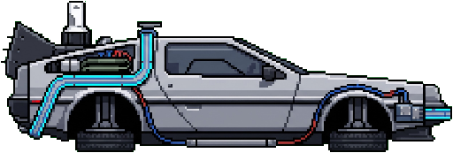

# 🚀 SONIC THRUST

<p align="center">
  
</p>

<p align="center">
  <strong>Navegador 2D de Física e Áudio em Neon com Propulsão Dupla Independente</strong><br />
  <em>"Domina a inércia com o poder de dois propulsores independentes e rasga o espaço ao som de uma banda sonora original eletrizante."</em>
</p>

<p align="center">
  <a href="https://github.com/mbgalego/sonic-thrust"></a>
  <a href="LICENSE.md"></a>
  <a href="public/tracks/LICENSE.md"></a>
  <a href="https://suno.com/@miguelius"></a>
</p>

---

## ⚡ Visão Geral

O **Sonic Thrust** é um jogo arcade de voo e precisão milimétrica em 2D desenvolvido com **React 19**, **Vite**, **TypeScript**, **Tailwind CSS v4** e **Web Audio API**.

Pilotando uma nave com **dois propulsores independentes** (Dual-Thruster), o jogador tem de atravessar montanhas-russas tubulares geradas proceduralmente a partir da frequência, andamento e energia da música. As paredes, curvas, obstáculos e equalizadores de fundo reagem em tempo real aos graves (*sub-bass* e *kick*), médios e agudos da faixa de áudio selecionada.

A regra de ouro é **Zero Contact**: o mais leve toque no teto, no chão ou nos obstáculos sonorreativos desfaz a nave num espetáculo de partículas néon.

---

## 🎮 Mecânicas Principais

### 1. Dinâmica de Propulsão Dupla (Dual Thrusters)
* **Motor Esquerdo** (`A` / `←` / Toque no lado esquerdo do ecrã): Aplica vetor de empuxo à esquerda, gerando torque de rotação no sentido horário.
* **Motor Direito** (`D` / `→` / Toque no lado direito do ecrã): Aplica vetor de empuxo à direita, gerando torque no sentido anti-horário.
* **Ambos os Motores em Simultâneo**: Voo vertical alinhado e aceleração frontal pura.
* **Voo 100% Manual**: Desenhado propositadamente sem estabilização automática (*Flight Assist desativado*), exigindo destreza motora e domínio completo da inércia.
* **Compensação de Deriva (*Drift Compensation*)**:
  * **LIGADO (Padrão)**: Voo estratégico e hover sem avanço forçado — a nave só progride quando inclinada para a frente.
  * **DESLIGADO**: Auto-cruise clássico de corrida contínua com avanço forçado sincronizado com o final da faixa.

### 2. Terreno Sonorreativo & Equalizador Bedrock
* **Geração Determinística por Semente de Áudio**: Cada faixa sonora computa um hash único a partir da duração e BPM, criando colinas, chicanes e cavernas exclusivas para essa música.
* **Analisador FFT Multi-Banda**: Segmentação em 6 bandas de frequência físicas (Sub-Bass 20-85Hz, Punch Bass 85-250Hz, Low-Mids 250-900Hz, High-Mids 900-4500Hz, Treble 4500-16000Hz e Presence).
* **Ondas Gravitacionais no Leito Rochoso**: As oscilações do equalizador propagam-se para fora do túnel (para dentro da rocha), mantendo a faixa central de voo 100% limpa e visível.
* **Gerador de Escudos por Proximidade**: Voar rente às paredes a alta velocidade liberta faíscas no radar e carrega um gerador inercial que concede Escudos de Fase gratuitos aos pilotos mais ousados.
* **Entrada Hipersónica**: A velocidades superiores a 450 km/h formam-se ondas de choque supersónicas de proa e rastos de plasma flamejante que se dissipam organicamente no vácuo.

### 3. Power-Ups Holográficos
| Ícone | Power-Up | Efeito |
| :---: | :--- | :--- |
| 🛡️ | **Escudo de Fase** (*Phase Shield*) | Absorve o próximo impacto contra terreno ou obstáculos. |
| 🟢 | **Amortecedor Sónico** (*Damper*) | Reduz a deformação do túnel em 78% durante 6 segundos. |
| 🟡 | **Gravidade Reduzida** (*Low-G*) | Microgravidade para navegação ultra-leve por 5 segundos. |
| 🔵 | **Pulso Sónico** (*Pulse*) | Onda de choque radial que desativa lasers e minas de ressonância. |
| 🟣 | **Modo Fantasma** (*Ethereal*) | Transparência quântica: atravessa qualquer obstáculo durante 6s. |
| 🔴 | **Invulnerabilidade** (*Invulnerable*) | Imunidade total e absorção de danos por 3.5 segundos. |
| ⏳ | **Distorção Temporal** (*Chrono Dilation*) | Bullet-time a 50% de velocidade com estase temporal. |
| 🌀 | **Singularidade** (*Singularity*) | Vórtice gravitacional que atrai todos os orbes e cristais. |

---

## 🎵 Banda Sonora Original & Catálogo de Faixas

Todas as faixas originais foram criadas e compostas por **[miguelius](https://suno.com/@miguelius)** e estão licenciadas sob **[Creative Commons Attribution 4.0 International (CC BY 4.0)](public/tracks/LICENSE.md)**.

### Faixas Padrão
1. **Hyper-Drive** (miguelius) — 140 BPM · 4:28
2. **Redux Abyssum** (Abyss Project) — 128 BPM · 5:00
3. **Classical Cybernetic** (miguelius) — 130 BPM · 4:05
4. **Cúig Nóiméad Eile** (miguelius) — 128 BPM · 4:25
5. **High Tech Cello** (miguelius) — 132 BPM · 3:59
6. **No Fear, No Ending** (miguelius) — 135 BPM · 4:05
7. **O Compasso da Saudade** (miguelius) — 120 BPM · 3:50
8. **Sonic Drift** (miguelius) — 118 BPM · 4:09
9. **Sonic Drive** (miguelius) — 126 BPM · 3:22
10. **Soundwave Drift** (miguelius) — 85 BPM · 3:38
11. **The flight... has ended** (miguelius) — 96 BPM · 1:47

### Faixas Secretas Desbloqueáveis
* **Neo Dreams (Dev's Secret Sound)** — 122 BPM · 3:48  
  *Desbloqueio: Vencer qualquer corrida na dificuldade PRO.*
* **OCD Dilacerado** — 143 BPM · 5:30  
  *Desbloqueio: Vencer qualquer corrida na dificuldade EXTREME.* Explosão dramática pós-rock com violoncelo dilacerante.
* **Welcome to the OASIS** (Sonic Thrust Labs) — 128 BPM · 4:00  
  *Exclusiva do Modo OASIS (Easter Egg).*

### Músicas de Derrota (Game Over)
Ao perder uma corrida, o motor de áudio escolhe aleatoriamente entre o tema clássico (*Sonic Thrust - Game Over.mp3*) e a versão alternativa (*Sonic Thrust - Game Over (alternative).mp3*).

### Importação de Música Local
O jogo inclui suporte completo para ficheiros do jogador (`MP3`, `WAV`, `OGG`, `FLAC`, `M4A`). Os ficheiros são descodificados e armazenados **exclusivamente no navegador do utilizador** via **IndexedDB** — nenhuma informação é enviada para servidores.

---

## 🕹️ Modos de Dificuldade

* **NORMAL**: 3 vidas, 1 escudo inicial, gravidade moderada (1.0x), densidade reduzida de obstáculos.
* **PRO**: 3 vidas, 0 escudos iniciais, gravidade normal (1.0x), lasers densos sincronizados com agudos. Desbloqueia *Neo Dreams*.
* **EXTREME**: 2 vidas, 0 escudos iniciais, gravidade agravada (1.30x), deformação extrema do túnel (0.70). Desbloqueia *OCD Dilacerado*.

---

## 🥚 Segredos & Easter Eggs

### 1. O Túnel Esquerdo & Modo OASIS
* Ao descolar, voar no sentido inverso (**para a esquerda, $x < 0$**) conduz a um túnel escuro e aparentemente infinito.
* Encontrar os **3 fragmentos de código** escondidos numa única corrida desbloqueia permanentemente:
  * **Skin DeLorean**: Réplica pixel-art do lendário carro de *Regresso ao Futuro*, com propulsão a jato nos eixos das rodas.
  * **Modo OASIS**: Paleta retrô anos 80 (magenta e violeta), criaturas pré-históricas animadas a assistir à passagem do jogador (**T-Rex** e **King Kong**), portal com a **Chave do OASIS** de brilho estelar sonorreativo e citações icónicas do filme *Ready Player One*.

### 2. Arquivo do Dev (Terminal Secreto)
* Clicar no nome do autor no rodapé do menu principal (*"Por Miguel Galego"*) abre uma janela de terminal estilizada de IDE com a história dos bastidores do jogo e ligação direta para a criação anterior: **Gravity Lander**.

---

## ⌨️ Controlos

| Ação | Teclado | Ecrã Tátil |
| :--- | :--- | :--- |
| **Propulsor Esquerdo** | `A` ou `Seta Esquerda (←)` | Tocar na metade esquerda do ecrã |
| **Propulsor Direito** | `D` ou `Seta Direita (→)` | Tocar na metade direita do ecrã |
| **Propulsão Dupla** | `A` + `D` ou `←` + `→` | Tocar em ambos os lados ao mesmo tempo |
| **Pausa** | `P` ou `ESC` | Botão de pausa na barra superior |
| **Ecrã Inteiro** | `F11` | Botão de alternância no cabeçalho |
| **Reiniciar (Menu Final)** | `Enter`, `Espaço` ou `R` | Botão "Tentar Novamente" |

---

## 🛠️ Instalação e Execução Local

### Pré-requisitos
* [Node.js](https://nodejs.org/) (versão 18 ou superior)
* [npm](https://www.npmjs.com/) ou [bun](https://bun.sh/)

### Passos
```bash
# 1. Clonar o repositório
git clone https://github.com/mbgalego/sonic-thrust.git
cd sonic-thrust

# 2. Instalar as dependências
npm install

# 3. Iniciar o servidor de desenvolvimento
npm run dev

# 4. Abrir no navegador em:
# http://localhost:3000
```

### Comandos Disponíveis
```bash
npm run dev       # Inicia o servidor Vite na porta 3000
npm run build     # Compila a aplicação para produção (/dist)
npm run preview   # Pré-visualiza a build de produção localmente
npm run lint      # Executa validação de tipos com TypeScript (tsc --noEmit)
```

---

## 🏗️ Arquitetura Técnica

* **Engine Gráfico Direct-Canvas (60 FPS)**: Renderizador 2D desenvolvido de raiz em `HTML5 Canvas`, contornando a reconciliação do React durante o voo para garantir 60 FPS consistentes em resoluções até 4K.
* **Física com Timestep Fixo**: Acumulador determinístico desacoplado da taxa de atualização do monitor (`1/60s`), garantindo comportamento físico idêntico em ecrãs de 60Hz, 120Hz ou 144Hz.
* **Web Audio API**: Pipeline com nós de áudio dedicados, analisador FFT de 1024 bandas com suavização de envelopes e pré-carregamento em cache LRU.
* **Responsive HUD**: Telemetria direta via referências de DOM (`GameHUDHandle`) sem re-renders de estado.

---

## 📜 Licenciamento e Créditos

* **Código Fonte**: Distribuído sob a licença **[MIT](LICENSE.md)**.
* **Banda Sonora Original**: Criada por **miguelius**, distribuída sob a licença **[Creative Commons Attribution 4.0 International (CC BY 4.0)](public/tracks/LICENSE.md)**.
  * Para partilha ou utilização das faixas noutros projetos, solicita-se apenas atribuição:  
    *Crédito: «miguelius» com ligação ao repositório [github.com/mbgalego/sonic-thrust](https://github.com/mbgalego/sonic-thrust) e perfil [suno.com/@miguelius](https://suno.com/@miguelius).*

---

<p align="center">
  Desenvolvido com dedicação por <strong>Miguel Galego</strong><br />
  <em>Visita também o jogo anterior: <a href="https://gravity-lander.ai.studio/">Gravity Lander</a></em>
</p>
